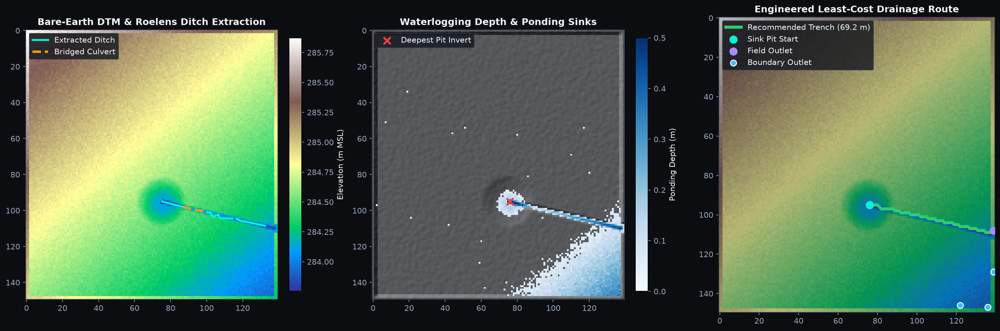
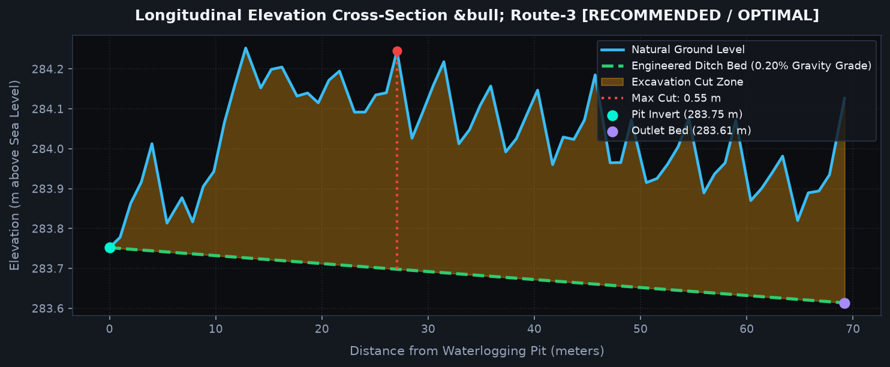
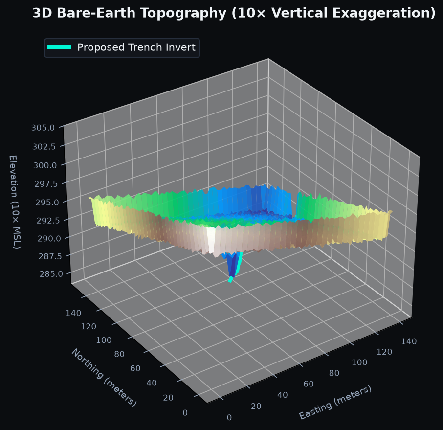
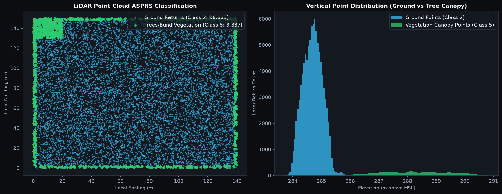

# 🌾 Field Drainage Using LiDAR
### *Intelligent LiDAR & Geospatial Agricultural Surface Drainage Decision System*

[](https://www.python.org/)
[](https://streamlit.io/)
[](https://www.whiteboxgeo.com/)
[](https://laspy.readthedocs.io/)
[](https://geopandas.org/)
[](https://plotly.com/)
[](LICENSE)
[](tests/)

---

## 📌 Executive Summary

Surface waterlogging and drainage congestion are primary drivers of crop failure, root asphyxiation, delayed sowing, and secondary soil salinization in agricultural holdings—especially across heavy clay soils (**Vertisols / Black Cotton Soils**) and canal command areas. Traditional manual land grading and drainage ditching often rely on subjective visual estimation, leading to inverted slopes, standing ponding pockets, and excessive excavation costs.

**Field Drainage Using LiDAR** is an intelligent, automated, **100% free-to-deploy** geospatial decision-support application. It processes high-resolution airborne/drone LiDAR point clouds (`.las`, `.laz`) and bare-earth digital elevation models (DEMs/DTMs) to:
1. **Classify and extract bare-earth ground returns** (ASPRS Class 2) while discarding vegetation canopy and field bund shrub noise.
2. **Model hydrology and concentrated runoff**: D8 flow direction, flow accumulation, natural streams, and catchment sub-basins powered by WhiteboxTools.
3. **Map genuine waterlogging depressions**: Distinguishes true ponding pockets from laser shot jitter and tillage roughness using depth, area, and volume thresholds.
4. **Extract existing ditch networks (Roelens et al., 2018)**: Relative Elevation Attribute (REA), dynamic Otsu thresholding, morphological skeletonization, and **machine-learning culvert / driveway bridging**.
5. **Recommend least-cost gravity-fed drainage routes**: Solves anisotropic cost surfaces to design optimal surface trench alignments from ponding pits to boundary outlets with guaranteed downhill slope ($\ge 0.2\%$, zero uphill sections) and exact earthwork volume estimates.
6. **Deliver interactive 2D animated GIS maps & 3D terrain exploration**: Folium maps with speed-proportional `AntPath` water pulses and Plotly 3D terrain with vertical exaggeration and simulated rainfall/flooding.
7. **Visual Comparison Mode**: Compare raw terrain vs. waterlogging risk vs. proposed ditch networks using synchronized side-by-side viewports or interactive swipe split-screen overlays.
8. **Automated PDF Drainage Engineering Reports & QGIS Exports**: Generates publication-grade multi-page ReportLab PDF reports (complete with high-DPI cartographic maps, ranked ditch specifications, and agronomic guidelines) plus 1-click GeoJSON and GeoTIFF downloads for independent QGIS verification.

---

## 🖼️ Dashboard & Application Showcase

### 1. Multi-Layer Interactive GIS Viewport
*Composite view featuring bare-earth DTM, extracted open ditches & bridged culverts, ponding waterlogging zones, and recommended least-cost gravity trenches.*



---

### 2. Longitudinal Trench Elevation Cross-Section Profile
*Engineering cross-section along the recommended trench showing natural ground elevation vs. the engineered monotonic gravity bed invert ($0.20\%$ grade) and shaded excavation cut depths.*



---

### 3. Interactive 3D Bare-Earth Terrain Model
*High-resolution 3D surface model with user-adjustable vertical exaggeration ($1\times\text{--}25\times$), 3D drainage trench centerline overlay, and interactive simulated flooding water surface.*



---

### 4. Airborne LiDAR Point Cloud Inspection & ASPRS Classification
*Classification breakdown showing bare-earth ground returns (ASPRS Class 2) filtered from tree and perimeter bund vegetation (Class 5), alongside point density and vertical return distribution.*



---

## ☁️ Can This Be Hosted Entirely for Free? **Yes! (100% Free)**

The system was architected from the ground up to run on **100% free, open-source dependencies** without proprietary licenses (no ArcGIS, no MATLAB, no paid cloud APIs). It can be deployed in the cloud completely free of cost with zero maintenance:

### Option 1: Streamlit Community Cloud (Recommended — 100% Free)
- **Cost:** \$0 / month (Free forever tier).
- **Features:** 1 GB container RAM, automated continuous deployment on `git push`, free HTTPS SSL, and custom subdomains (e.g. `field-drainage-lidar.streamlit.app`).
- **WhiteboxTools & laspy compatibility:** Precompiled wheels for `laspy[lazrs]`, `rasterio`, `scipy`, and `whitebox` install automatically on Streamlit Cloud's Debian Linux environment.

#### Deployment Steps:
1. Fork or push this repository to your GitHub account: `https://github.com/<your-username>/field-drainage-lidar`.
2. Visit [share.streamlit.io](https://share.streamlit.io/) and log in with your GitHub account.
3. Click **"New app"**.
4. Select:
   - **Repository:** `<your-username>/field-drainage-lidar`
   - **Branch:** `master`
   - **Main file path:** `app.py`
5. Click **"Deploy!"** Your application will be live in 2–3 minutes.

### Option 2: Hugging Face Spaces (Alternative — 100% Free)
- **Cost:** \$0 / month.
- **Specs:** 16 GB RAM, 2 vCPUs on the free CPU Basic tier.
- Create a Space, choose the **Streamlit** SDK, link your GitHub repository, and it builds and launches automatically.

---

## 🧪 Sample Datasets for Testing & Experimentation

### 1. Built-in Instant One-Click Demos
The application includes pre-generated synthetic benchmark datasets designed to simulate typical smallholder agricultural plots in Indian UTM CRS (`EPSG:32644`):
- **`data/sample/synthetic_indian_farm.tif`**: 1-meter spatial resolution GeoTIFF covering a 5-acre field with a gentle $0.8\%$ planar slope, a central waterlogging depression, perimeter bunds (*medh/daul*), and a natural discharge outlet gap.
- **`data/sample/synthetic_indian_farm.las`**: 100,000-point airborne LiDAR point cloud ($\sim 4.8\text{ pts/m}^2$) with ASPRS Class 2 (Ground) and Class 5 (Vegetation) returns, featuring a $7\text{ m}$ driveway / road plug crossing to test culvert connectivity bridging.

### 2. Real-World Agricultural Sample Dataset (Radiant Earth / Source Cooperative)
To experiment with real-world satellite imagery and agricultural land elevation from India, you can download sample GeoTIFF files from the **Radiant Earth AgriFieldNet India Competition** hosted on [Source Cooperative](https://source.coop/):

🔗 **Direct Sample GeoTIFF URL:**  
[https://data.source.coop/radiantearth/agrifieldnet-competition/source/ref_agrifieldnet_competition_v1_source_06d05/ref_agrifieldnet_competition_v1_source_06d05_B01_10m.tif](https://data.source.coop/radiantearth/agrifieldnet-competition/source/ref_agrifieldnet_competition_v1_source_06d05/ref_agrifieldnet_competition_v1_source_06d05_B01_10m.tif)

#### Quick Download Command:
```bash
# Download the real-world agricultural test file directly into data/sample/
curl -o data/sample/agrifieldnet_sample_10m.tif "https://data.source.coop/radiantearth/agrifieldnet-competition/source/ref_agrifieldnet_competition_v1_source_06d05/ref_agrifieldnet_competition_v1_source_06d05_B01_10m.tif"
```
You can then upload `agrifieldnet_sample_10m.tif` directly into the web dashboard sidebar to test coordinate ingestion, CRS reprojection validation, and terrain slope analysis!

---

## 🛠️ Complete Open-Source Technology Stack

| Capability | Free Open-Source Library | Replaces (Commercial / Paid) |
|---|---|---|
| **Point Cloud Ingestion & Decompression** | `laspy` + `lazrs` (C/Rust engine) | TerraScan, FugroViewer, Global Mapper |
| **Raster Ingestion & Spatial Math** | `rasterio`, `numpy`, `scipy` | ArcGIS Pro, ERDAS IMAGINE |
| **Hydrological Processing Engine** | `whitebox` (WhiteboxTools Open Core) | ArcGIS Spatial Analyst / ArcHydro |
| **Ditch Extraction & Computer Vision** | `scikit-image`, `scikit-learn` | Commercial Photogrammetry Toolkits |
| **Vector Geometry & Networks** | `shapely`, `geopandas`, `networkx`, `pyproj` | ESRI ArcPy, FME |
| **Interactive 2D Mapping** | `folium`, `streamlit-folium`, `AntPath` | ArcGIS Online, Leaflet Commercial |
| **Interactive 3D Terrain** | `plotly` (`go.Surface`, `go.Scatter3d`) | Cesium Ion, ArcGIS 3D Scenes |
| **Longitudinal Profiles** | `matplotlib` | Civil 3D Profile Tools |
| **PDF Drainage Feasibility Reports** | `reportlab`, `matplotlib` | HydroCAD, Civil 3D Sheet Sets |
| **Application UI & Caching** | `streamlit` (`@st.cache_data`) | Custom Full-Stack React/Node |

---

## 🚀 Local Installation & Quickstart

```bash
# 1. Clone the repository
git clone https://github.com/varadrz/field-drainage-lidar.git
cd field-drainage-lidar

# 2. Create and activate a Python virtual environment (Python 3.10+)
python -m venv venv
# On Windows (PowerShell):
.\venv\Scripts\Activate.ps1
# On macOS / Linux:
source venv/bin/activate

# 3. Install 100% free dependencies
pip install -r requirements.txt

# 4. (Optional) Run test suite to verify all modules
pytest

# 5. Launch the Streamlit dashboard
streamlit run app.py
```

The application will start immediately at `http://localhost:8501`.

---

## 🏛️ System Architecture

```
field-drainage-lidar/
├── app.py                           # High-performance Streamlit web dashboard
├── components/
│   ├── maps.py                      # Multi-layer Folium Leaflet maps with animated AntPath flow
│   ├── charts.py                    # Plotly 3D terrain surface with flood simulation
│   └── elevation_profile.py         # Longitudinal trench cross-section profile generator
├── modules/
│   ├── data_loader.py               # Robust GeoTIFF loader & CRS validation
│   ├── elevation_analysis.py        # Elevation relief and area metrics
│   ├── terrain_analysis.py          # Horn 3x3 slope, aspect, hillshade, vector contours
│   ├── hydrology.py                 # WhiteboxTools depression filling, D8 accumulation, streams
│   ├── drainage_recommendation.py   # Least-cost path routing, monotonic invert profiling, cut/fill
│   ├── lidar_processor.py           # laspy LAS/LAZ ingestion, ASPRS Class 2 filtering, 1m DTM
│   ├── drainage_extraction.py       # Roelens et al. (2018) REA, Otsu, skeletonization & culvert bridging
│   └── report_generator.py          # Publication-grade ReportLab PDF builder with cartographic maps
├── scripts/
│   ├── generate_synthetic_farm.py   # 1m synthetic GeoTIFF generator (EPSG:32644)
│   ├── generate_synthetic_lidar.py  # 100k-point synthetic LAS generator with culvert gap
│   └── export_readme_assets.py      # Automated generator for README visual assets
├── tests/
│   ├── test_elevation.py            # Phase 1 unit tests
│   ├── test_terrain.py              # Phase 2 unit tests
│   ├── test_hydrology.py            # Phase 3 unit tests
│   ├── test_drainage.py             # Phase 4 unit tests
│   ├── test_lidar.py                # Phase 5 unit tests
│   └── test_report.py               # Phase 6 PDF & export tests (35 total tests)
└── requirements.txt                 # Pinned open-source dependencies
```

---

## 🔬 Scientific Methodology & References

1. **Roelens, J., Höfle, B., Dondeyne, S., Orshoven, J. V., & Diels, J. (2018).** *Agricultural ditch extraction from airborne LiDAR data.* **Science of The Total Environment**, 634, 1378–1388. [https://doi.org/10.1016/j.scitotenv.2018.04.045](https://doi.org/10.1016/j.scitotenv.2018.04.045)
2. **Lindsay, J. B. (2016).** *Whitebox GAT: A case study in open-source GIS software development.* **Computers & Geosciences**, 95, 75–84.
3. **O'Callaghan, J. F., & Mark, D. M. (1984).** *The extraction of drainage networks from digital elevation data.* **Computer Vision, Graphics, and Image Processing**, 28(3), 323–344.
4. **Horn, B. K. (1981).** *Hill shading and the reflectance map.* **Proceedings of the IEEE**, 69(1), 14–47.

---

## 📜 Intellectual Property & License

Copyright (c) 2026 Varad Patil. All Rights Reserved.  
This software, algorithms, and documentation are proprietary. See [LICENSE](LICENSE) for terms.
