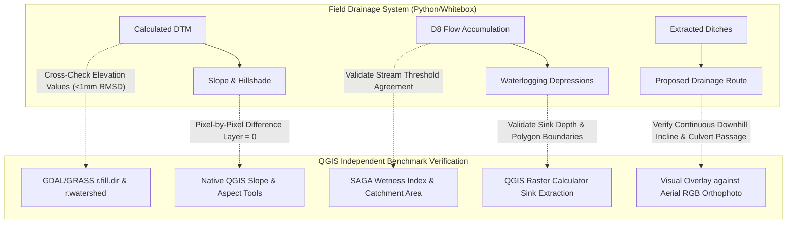

# 01: Ideation & Requirements Specification

## 1. Problem Breakdown: The Indian Agricultural Drainage Crisis

### 1.1 Agronomic & Soil Context
In Indian agriculture, soil drainage is frequently neglected in comparison to irrigation infrastructure. However, excessive moisture and surface ponding cause catastrophic yield losses across several major agro-climatic zones:
- **Vertisols (Black Cotton Soils):** Prevalent in Maharashtra (Vidarbha, Marathwada), Madhya Pradesh, and Gujarat. These smectite-rich montmorillonite clay soils exhibit extreme swelling upon wetting and shrinkage upon drying. Saturated hydraulic conductivity ($K_{sat}$) drops near zero when saturated, creating prolonged surface ponding even under mild monsoon rainfall.
- **Canal Command Salinization:** In Punjab, Haryana, and Rajasthan (Indira Gandhi Canal project), continuous flood irrigation coupled with inadequate surface drainage has caused groundwater tables to rise into root zones, dragging dissolved salts upward via capillary action and causing severe secondary salinization.
- **Kharif Flash Inundation:** During the South-West Monsoon, heavy precipitation events exceed field infiltration rates. Without functional field drainage, crops like soybean, cotton, pulses, and maize suffer from root-zone hypoxia within 24 to 48 hours, leading to root rot and chlorosis.

### 1.2 Micro-Topography and Field Bunds (*Medh/Daul*)
Unlike large contiguous Western grain farms, Indian agricultural landscapes are fragmented into smallholder parcels (typically 0.5 to 2.5 hectares). Each parcel is bounded by earthen ridges or field bunds (*medh* or *daul*) erected for boundary demarcation and moisture conservation. 
- While bunds retain water during dry spells, they act as miniature dams during torrential downpours.
- Historical natural drainage lines (talwegs, small streams, *nallas*) have been encroached upon, silted up, or severed by rural farm roads without adequate culvert placement.
- When water accumulates in low-lying micro-depressions within a field, farmers resort to ad-hoc, manual breaching of bunds, frequently flooding downstream neighbors and triggering rural disputes.

---

## 2. Target Personas

```
+-------------------------------------------------------------------------------------------------+
|                                        TARGET PERSONAS                                          |
+-------------------------------------------------------------------------------------------------+
| 1. Agricultural Extension Officers & KVK Agronomists (Krishi Vigyan Kendras)                    |
|    - Goal: Provide scientific land-grading and surface-drainage plans to village clusters.     |
|    - Technical Level: Moderate; needs intuitive visual maps, elevation profiles, and PDF docs. |
+-------------------------------------------------------------------------------------------------+
| 2. Precision Agriculture Consultants & Drone Surveyors                                          |
|    - Goal: Ingest drone LiDAR / photogrammetry DSM/DTM to recommend cut-and-fill drainage runs.  |
|    - Technical Level: High; requires GeoJSON/GeoTIFF exports, CRS fidelity, slope calculations. |
+-------------------------------------------------------------------------------------------------+
| 3. Progressive Farmers & Farm Cooperatives                                                      |
|    - Goal: Understand where water stagnates and where to dig gravity ditches to the outlet.    |
|    - Technical Level: Low-to-Moderate; requires clear aerial overlay, risk zones, actionable.  |
+-------------------------------------------------------------------------------------------------+
| 4. Watershed & Hydrological Researchers                                                         |
|    - Goal: Benchmark flow accumulation models and ditch-network extraction algorithms.         |
|    - Technical Level: Expert; validates against published academic literature and QGIS ground truth. |
+-------------------------------------------------------------------------------------------------+
```

---

## 3. Requirements Specification

### 3.1 Functional Requirements (FR)

| Req ID | Module | Description | Acceptance Criteria |
|---|---|---|---|
| **FR-01** | Ingestion | Ingest LiDAR point cloud formats (`.las`, `.laz`) and elevation rasters (`.tif`, GeoTIFF). | Ingests without error; parses point cloud classes (ASPRS standard); extracts resolution, dimensions, bounds, and CRS metadata. |
| **FR-02** | DTM Generation | Filter LiDAR point clouds for bare earth (ASPRS Class 2) and interpolate to a raster DTM using Triangulated Irregular Network (TIN) or Inverse Distance Weighting (IDW). | Output is a metric GeoTIFF with preserved spatial resolution (0.5m–1m for LiDAR; native for DEM); no un-interpolated NoData holes inside field bounds. |
| **FR-03** | Terrain Analysis | Compute basic terrain attributes: Minimum, Maximum, Mean elevation, Slope (degrees and percent), Aspect, Contours (0.25m / 0.5m interval), and multi-directional Hillshade. | Rasters match analytical ground truth calculated in QGIS GDAL/GRASS tools within <0.1% tolerance. |
| **FR-04** | Hydrological Modeling | Compute D8 flow directions, flow accumulation grids, and stream networks using WhiteboxTools. | Flow paths correctly honor slope gradients; flow accumulation highlights natural drainage lines and concentrated run-off pathways. |
| **FR-05** | Sink Discrimination | Discriminate between genuine field ponding depressions and high-frequency sensor/DEM noise using depth, area, and persistence filtering. | Depressions shallower than threshold (e.g., 5 cm) or smaller than 3 px are treated as noise; genuine depressions are delineated with volume and surface area. |
| **FR-06** | Ditch Extraction | Implement Roelens et al. (2018) morphological ditch extraction: Relative Elevation Attribute (REA), Otsu thresholding, skeletonization, lowest-LiDAR-point snapping. | Extracts linear ditch centerlines; correctly identifies severed connections across farm tracks/culverts. |
| **FR-07** | Drainage Routing | Propose gravity-fed surface trench routes connecting waterlogging depressions to the lowest boundary pour point (outlet). | Generated routes maintain monotonic downward slope (>0.2%); minimum earthwork distance selected; cut-and-fill volume estimated. |
| **FR-08** | Interactive UI | Interactive Streamlit web app with Folium map, layer toggles, split-screen/comparison mode, and elevation cross-section profiler. | Seamless toggle between Hillshade, DTM, Flow Accumulation, Waterlogging Zones, and Proposed Routes; interactive tooltip on click. |
| **FR-09** | Reporting & Export | Generate an automated multi-page PDF Drainage Plan Report via ReportLab, and export vectors (GeoJSON/GPKG) and rasters (GeoTIFF). | PDF compiles with maps, summary tables, engineering recommendations, and legal disclaimers; GeoJSON opens in QGIS without CRS shifts. |

### 3.2 Non-Functional Requirements (NFR)

- **NFR-01: Zero-Cost Licensing & Open Architecture:** The entire system must execute using 100% free, open-source software libraries. No proprietary ESRI licenses (ArcGIS, ArcPy), commercial point-cloud suites (TerraScan, Global Mapper), or paid mapping APIs (Google Maps Platform, Mapbox) are permitted.
- **NFR-02: Strict Metric & CRS Integrity:** Indian agricultural projects must operate in metric units (meters, hectares, cubic meters). All geospatial coordinates must be projected into appropriate Projected Coordinate Reference Systems (UTM Zone 43N - EPSG:32643 or UTM Zone 44N - EPSG:32644). Geographic coordinates (WGS84 - EPSG:4326) are restricted strictly to web map leaflet overlays.
- **NFR-03: Execution Performance:** A standard 50-hectare agricultural field surveyed at 0.5m LiDAR resolution (~2 million points) must complete end-to-end hydrological and morphological analysis in less than 45 seconds on a standard modern multi-core laptop (16GB RAM, 8-core CPU).
- **NFR-04: Robust Error Handling & Data Validation:** Uploaded datasets with missing CRS, non-projected degree units, negative elevation outliers, or corrupted headers must be flagged with user-friendly actionable diagnostic messages rather than silent crashes.

---

## 4. Scope Boundaries

```
+-------------------------------------------------------------------------------------------------+
|                                     SCOPE BOUNDARIES (v1.0)                                     |
+-------------------------------------------------------------------------------------------------+
| IN SCOPE (Version 1.0)                                                                          |
| - High-resolution surface elevation modeling (LiDAR & raster DEMs).                             |
| - Micro-topography analysis: Slope, Aspect, Hillshade, Contours.                                |
| - Surface ponding and waterlogging detection (volume, area, depth).                             |
| - Morphological surface ditch extraction based on Roelens et al. (2018).                        |
| - Surface ditch connectivity bridging across severed culverts/ridges.                          |
| - Surface gravity-fed trench alignment planning (cut/fill profile, positive gradient).          |
| - 3-Tier Data Support (Copernicus DEM, USGS 3DEP LiDAR, Synthetic Indian Farm).                |
| - Interactive Streamlit web interface and automated ReportLab PDF export.                       |
+-------------------------------------------------------------------------------------------------+
| OUT OF SCOPE (Deferred to Future Versions)                                                      |
| - Subsurface tile drainage design (perforated PVC/corrugated pipe depth, spacing, drainage     |
|   coefficients using Hooghoudt's equation, soil hydraulic conductivity envelopes).             |
| - Dynamic hydro-meteorological storm-surge routing (e.g., SWMM 1D/2D unsteady flow modeling).   |
| - Mechanical pumping station sizing and electrical lift calculations.                           |
| - Real-time IoT soil-moisture sensor integration.                                               |
| - Automated legal cadastre land-title boundary dispute resolution.                              |
+-------------------------------------------------------------------------------------------------+
```

---

## 5. Independent Verification Strategy Using QGIS

To ensure scientific rigor and eliminate software hallucination, all algorithmic modules must be independently validated against **QGIS (v3.28 LTR or newer)** using standard geospatial reference tools:



### Protocol for Verification:
1. **DTM Fidelity:** Load system-generated DTM and raw LiDAR points into QGIS. Create an elevation difference raster (`System_DTM - QGIS_TIN_Interpolation`). The Root Mean Square Difference (RMSD) must be $<0.02\text{ m}$.
2. **Hydrological Agreement:** Run `r.watershed` in QGIS GRASS toolbox on the same conditioned DTM. Compare the resulting stream raster with WhiteboxTools `D8FlowAccumulation`. Stream channels with accumulation $>1,000\text{ cells}$ must exhibit $>95\%$ spatial overlap (Dice Similarity Coefficient).
3. **Ditch Extraction Validation:** Export extracted ditch centerlines as GeoJSON. Overlay in QGIS over high-resolution satellite imagery or synthetic ground truth vectors. Measure buffer precision ($1.0\text{ m}$ tolerance) and topological connectivity (no false dead-ends across road crossings).
