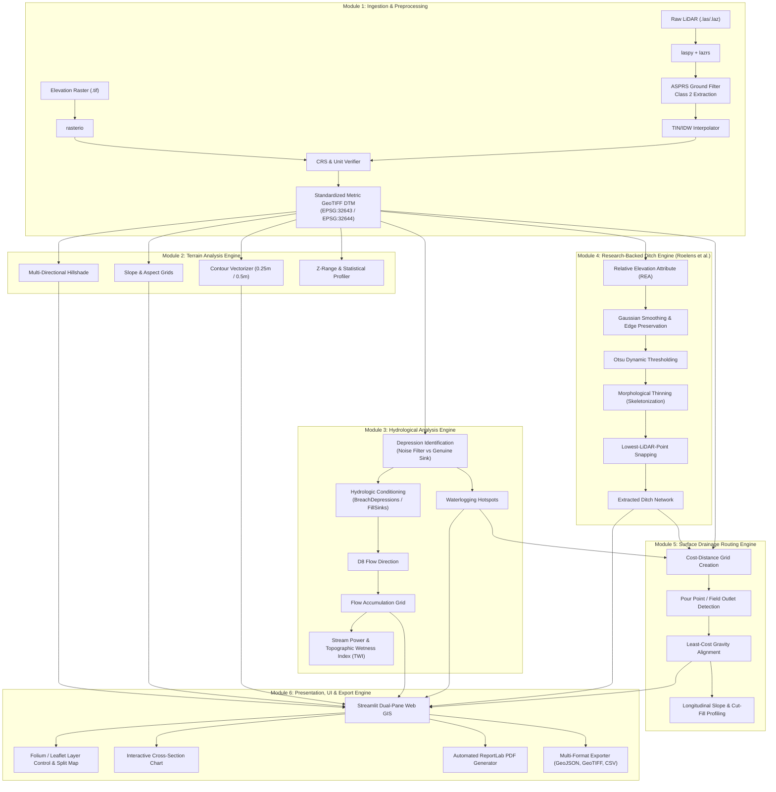
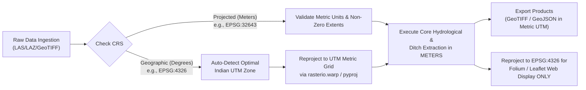

# 02: System Architecture Specification

## 1. High-Level Modular Architecture

The **Field Drainage Using LiDAR** system is engineered on a strict decoupled, 6-module architecture separating headless geospatial computational engines from the interactive presentation tier.



---

## 2. Directory Structure & File Hierarchy

The repository adheres to production-grade Python packaging standards, separating business logic, UI components, static assets, tests, and documentation:

```
field-drainage-lidar/
│
├── .gitignore                      # Geospatial & Python exclusion rules
├── LICENSE                         # Strict proprietary copyright notice
├── README.md                       # Master repository documentation
├── requirements.txt                # Pinned 100% free Python dependencies
├── setup.py                        # Optional local package installation setup
│
├── app.py                          # Streamlit application entry point
│
├── modules/                        # Headless Core GIS & Algorithmic Engines
│   ├── __init__.py
│   ├── ingestion.py                # LiDAR & GeoTIFF parser, CRS validator
│   ├── terrain.py                  # Slope, aspect, hillshade, contours
│   ├── hydrology.py                # WhiteboxTools wrapper (D8, flow acc, sinks)
│   ├── ditch_extraction.py         # Roelens et al. (2018) REA & skeletonization
│   ├── drainage_routing.py         # Gravity pour point & least-cost path routing
│   └── report_generator.py         # ReportLab automated PDF builder
│
├── components/                     # Streamlit Presentation & UI Components
│   ├── __init__.py
│   ├── map_view.py                 # Folium dual-pane & layer toggle renderer
│   ├── elevation_profile.py        # Matplotlib/Plotly cross-section visualizer
│   ├── stats_cards.py              # Metric summary widgets & KPIs
│   └── sidebar.py                  # Input file selection & parameter controls
│
├── utils/                          # Common Utilities & Geospatial Helpers
│   ├── __init__.py
│   ├── crs_utils.py                # Reprojection, UTM auto-detection, metric bounds
│   ├── synthetic_data.py           # Programmatic Synthetic Indian Farm generator
│   └── logger.py                   # Structured application logging
│
├── data/                           # Data Directories (Ignored by Git)
│   ├── input/                      # Raw .las, .laz, .tif input files (.gitkeep)
│   └── processed/                  # Cached intermediate rasters (.gitkeep)
│
├── outputs/                        # Output Deliverables (Ignored by Git)
│   ├── rasters/                    # Exported GeoTIFFs (DTM, slope, flow acc)
│   ├── vectors/                    # Exported GeoJSON / Shapefiles
│   └── reports/                    # Generated PDF drainage reports
│
├── tests/                          # Automated Unit & Integration Tests
│   ├── __init__.py
│   ├── test_ingestion.py           # Ingestion & CRS validation tests
│   ├── test_terrain.py             # Terrain computation tests
│   ├── test_hydrology.py           # WhiteboxTools workflow tests
│   ├── test_ditch_extraction.py    # Roelens et al. algorithm tests
│   └── test_synthetic.py           # Synthetic generator integrity tests
│
└── docs/                           # System Documentation & Specifications
    ├── 01_IDEATION_AND_REQUIREMENTS.md
    ├── 02_SYSTEM_ARCHITECTURE.md
    ├── 03_ALGORITHMS_AND_DATAFLOW.md
    ├── 04_TECH_STACK_AND_DATA_STRATEGY.md
    └── 05_DEVELOPMENT_ROADMAP.md
```

---

## 3. Separation of Concerns: GIS Engine vs. Streamlit UI

To ensure modularity, scalability, and automated testing, the codebase enforces an absolute separation between the computation layer and the interface layer:

1. **Zero UI Code in `modules/`:** 
   - Core functions in `modules/` are pure Python/NumPy/Rasterio/GeoPandas functions.
   - They take file paths, arrays, or GeoDataFrames as inputs and return in-memory structures or write standardized output files.
   - Under no circumstances should `streamlit`, `st.*`, or display widgets be imported within `modules/`. This allows core logic to run in headless CLI scripts, batch pipelines, or automated test runners (`pytest`).
2. **Stateless Processing & Caching:**
   - Streamlit manages application state using `@st.cache_data` and `@st.cache_resource` for heavy raster/point-cloud loads.
   - Computational results (e.g., flow accumulation grids) are cached to disk in `data/processed/` using hash-based naming to prevent redundant re-computation upon UI interaction.
3. **Presentation Exclusivity in `components/` and `app.py`:**
   - The UI layer only receives computed outputs (arrays, GeoDataFrames, metrics) and transforms them into interactive Leaflet maps, Plotly charts, and ReportLab canvas tables.

---

## 4. Coordinate Reference System (CRS) & Metric Unit Handling

Accurate slope, hydraulic length, and earthwork cut-and-fill computations require strictly conformal, metric Projected Coordinate Reference Systems. Processing in geographic coordinates (EPSG:4326 - WGS84 latitude/longitude degrees) leads to catastrophic distortion in distance and area calculations.



### 4.1 Indian UTM Zone Allocation Logic
Indian agricultural landscapes span primarily UTM Zones 42N through 45N:
- **UTM Zone 43N (EPSG:32643):** Western & Central India (Gujarat, Maharashtra, Western Madhya Pradesh, Karnataka, Kerala, Western Rajasthan). Longitude bounds: $72^\circ\text{E}$ to $78^\circ\text{E}$.
- **UTM Zone 44N (EPSG:32644):** Central & Eastern India (Eastern Madhya Pradesh, Telangana, Andhra Pradesh, Chhattisgarh, Odisha, Uttar Pradesh, Bihar). Longitude bounds: $78^\circ\text{E}$ to $84^\circ\text{E}$.
- **UTM Zone 42N (EPSG:32642):** Far Western Border (Western Rajasthan, Punjab border). Longitude bounds: $66^\circ\text{E}$ to $72^\circ\text{E}$.
- **UTM Zone 45N (EPSG:32645):** Eastern India & Bengal Basin (West Bengal, Assam, North-East). Longitude bounds: $84^\circ\text{E}$ to $90^\circ\text{E}$.

### 4.2 Auto-Detection Formula
When an unprojected input raster or point cloud is ingested, the system reads its centroid longitude ($\lambda$) and applies the standard UTM formula:
$$\text{Zone Number} = \left\lfloor \frac{\lambda + 180}{6} \right\rfloor + 1$$
For northern hemisphere India:
$$\text{Target EPSG} = 32600 + \text{Zone Number}$$
If an ingested dataset lacks any spatial projection header, the pipeline halts immediately, presenting the user with an explicit CRS Selection Dialog rather than guessing blindly.
