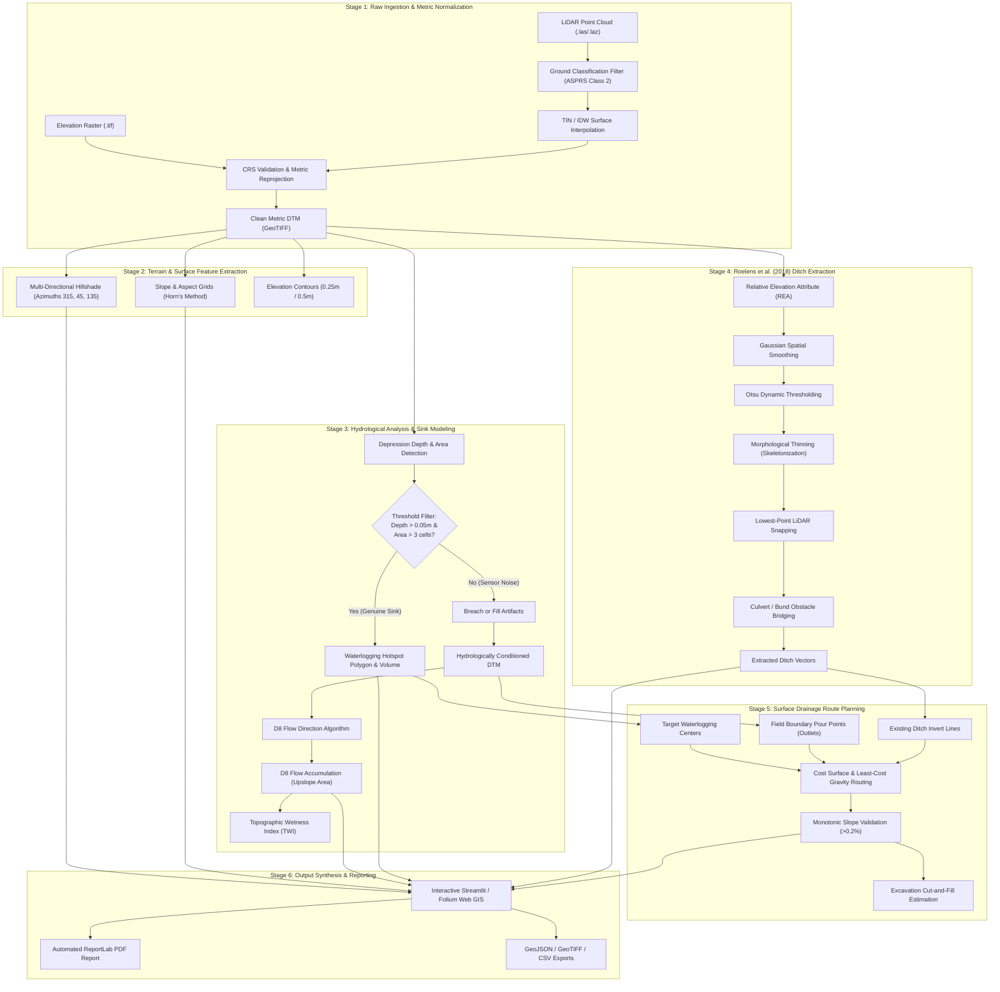
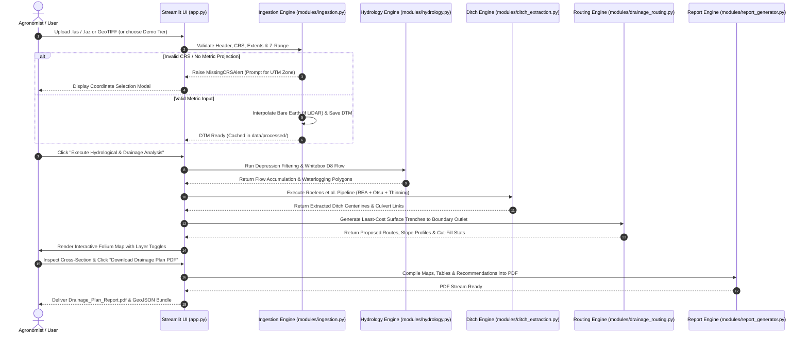
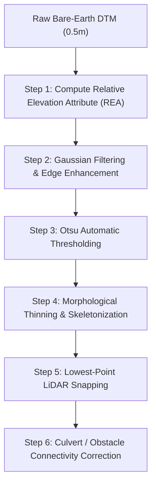

# 03: Algorithms & Data Flow Specification

## 1. End-to-End Data Pipeline Architecture

The data pipeline processes raw topographical measurements through progressive hydrological conditioning, morphological feature extraction, and graph-based routing:



---

## 2. System Interaction Sequence

The following sequence diagram outlines user interactions, validation routines, background processing, and deliverable rendering:



---

## 3. Hydrological Pipeline Deep Dive (WhiteboxTools)

Hydrological analysis is powered by the high-performance Rust-backed **WhiteboxTools Open Core**, interfaced through the `whitebox` Python wrapper.

### 3.1 Depression Handling: Selective Breaching vs. Sink Filling
Standard GIS software blindly applies "sink filling" (e.g., Wang & Liu, 2006). In flat agricultural terrain, blind filling artificially raises depressions up to their spill point, obliterating micro-topography and masking the very waterlogging zones the farmer needs to remediate.
- **Selective Breaching (`BreachDepressions`):** Carves a narrow channel through the lowest sill/ridge holding water in the sink. This preserves the natural bed elevation of depressions while establishing a continuous downhill flow path.
- **Depression Volume & Depth Mapping (`Sink` & `DepthInSink`):**
  $$\text{Depth}(x,y) = \text{DTM}_{\text{filled}}(x,y) - \text{DTM}_{\text{raw}}(x,y)$$
  $$\text{Volume} = \sum_{(x,y) \in \text{Sink}} \text{Depth}(x,y) \times (\Delta x \times \Delta y)$$

### 3.2 D8 Flow Direction and Accumulation
- **Deterministic 8-Neighbor (D8) Flow Direction:** Assigns flow from each grid cell to one of its eight steepest downslope neighbors:
  $$S = \frac{Z_{\text{center}} - Z_{\text{neighbor}}}{L}$$
  where $L = \Delta x$ for cardinal neighbors and $L = \sqrt{2}\Delta x$ for diagonal neighbors.
- **Flow Accumulation (Upslope Contributing Area):** Counts the cumulative number of upstream cells draining through each cell.
- **Topographic Wetness Index (TWI):** Characterizes steady-state wetness potential:
  $$\text{TWI} = \ln\left( \frac{\alpha}{\tan\beta} \right)$$
  where $\alpha$ is the specific catchment area ($m^2/m$) and $\beta$ is the local slope angle in radians.

---

## 4. Roelens et al. (2018) Ditch Extraction Pipeline

Agricultural field ditches are narrow linear depressions (often 0.5m to 1.5m wide and 0.3m to 0.8m deep) typically obscured by weeds, crop canopy, or embankments. The system implements the peer-reviewed methodology of **Roelens et al. (2018)** (*"Agricultural ditch extraction from airborne LiDAR data"*):



### Step 1: Relative Elevation Attribute (REA)
The REA enhances local linear depressions by subtracting the maximum or mean elevation within a circular neighborhood of radius $R$ (calibrated to the expected maximum ditch width, typically $R = 2.5\text{ m}$ to $3.5\text{ m}$):
$$\text{REA}(x, y) = Z(x, y) - \max_{(u, v) \in \mathcal{N}_R(x, y)} Z(u, v)$$
In flat fields, non-ditch terrain yields $\text{REA} \approx 0$, while ditch beds yield significant negative values ($\text{REA} < -0.25\text{ m}$).

### Step 2: Gaussian Spatial Filtering
To remove micro-roughness caused by plowing furrows (*clods and tillage rows*), a 2D Gaussian kernel ($\sigma = 1.0$) is applied to smooth high-frequency spatial variation without displacing the ditch centerline:
$$G(x, y) = \frac{1}{2\pi\sigma^2} \exp\left(-\frac{x^2 + y^2}{2\sigma^2}\right)$$

### Step 3: Otsu Automatic Dynamic Thresholding
Rather than requiring user-defined hardcoded elevation thresholds, **Otsu's thresholding** evaluates the histogram of negative REA values and identifies the optimal threshold $T^*$ that minimizes intra-class variance:
$$\sigma_w^2(T) = \omega_0(T)\sigma_0^2(T) + \omega_1(T)\sigma_1^2(T)$$
Pixels satisfying $\text{REA}(x,y) \le T^*$ are flagged as candidate ditch pixels.

### Step 4: Morphological Thinning & Skeletonization
The binary candidate ditch mask is reduced to 1-pixel-wide topological skeletons using the Medial Axis Transform / Zhang-Suen thinning algorithm. This preserves centerline geometry, bifurcations, and end points while discarding redundant lateral width.

### Step 5: Lowest-Point LiDAR Snapping
Interpolated raster centerlines can suffer minor spatial shifts. The skeletonized vertices are snapped to the minimum elevation LiDAR ground return within a perpendicular $0.75\text{ m}$ search radius, ensuring the vector sits directly at the physical invert of the channel.

### Step 6: Culvert & Road Obstacle Connectivity Bridging
Farm tracks, culverts, and sediment plugs often appear in elevation models as localized dams, fragmenting a continuous ditch into disconnected segments. 
- The system evaluates vector end-points within a distance threshold $D_{\text{max}} = 15\text{ m}$.
- If two ditch segments align within an azimuth difference $\Delta\theta \le 30^\circ$ and exhibit a consistent downstream hydraulic gradient:
  $$\Delta Z = Z_{\text{upstream}} - Z_{\text{downstream}} > 0$$
  the gap is automatically bridged with a synthetic culvert vector attribute.

---

## 5. Discriminating Genuine Ponding Depressions from DEM Noise

A critical vulnerability of automated hydrological modeling is confusing high-frequency surface noise (sensor errors, laser shot jitter, tractor wheel ruts) with real, agronomically damaging waterlogging depressions.

The system applies a three-stage geometric and volumetric filter:

```
+-------------------------------------------------------------------------------------------------+
|                         DEPRESSION DISCRIMINATION FILTER LOGIC                                 |
+-------------------------------------------------------------------------------------------------+
| 1. Minimum Depth Threshold (Delta Z >= 0.05 m):                                                 |
|    - Micro-depressions shallower than 5 cm are ignored as surface tillage roughness.            |
+-------------------------------------------------------------------------------------------------+
| 2. Minimum Area Threshold (Area >= 3 connected cells):                                          |
|    - Single isolated pixel sinks are flagged as laser interpolation artifacts and eliminated.   |
+-------------------------------------------------------------------------------------------------+
| 3. Volume & Persistence Metric (Vol >= Area * 0.03 m):                                          |
|    - The ratio of volume to surface area must indicate meaningful storage capacity              |
|      (Storage >= 150 Liters) to qualify as a primary remediation target.                        |
+-------------------------------------------------------------------------------------------------+
```

Depressions surviving this filter are vectorized into GeoJSON polygons, color-coded by waterlogging risk category (Low, Moderate, Severe), and assigned priority IDs for downstream drainage routing.
