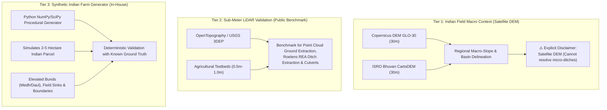

# 04: Technology Stack & 3-Tier Data Strategy

## 1. 100% Free Technology Stack Specification

Every library and dependency in this project has been selected to ensure **zero financial cost, zero proprietary vendor lock-in, and full open-source auditability**.

```
+-------------------------------------------------------------------------------------------------+
|                                 OPEN-SOURCE VS. COMMERCIAL MAPPING                              |
+-------------------------------------------------------------------------------------------------+
| Open-Source Tool (Field Drainage)   | Commercial Alternative Replaced   | Technical Justification|
+-------------------------------------+-----------------------------------+------------------------+
| Python 3.10+                        | MATLAB / IDL                      | Universal ecosystem.   |
| laspy + lazrs                       | TerraScan / FugroViewer / GlobalM | High-speed LAS/LAZ IO. |
| rasterio (GDAL bindings)            | ArcMap / ArcGIS Pro (Spatial Ext) | Fast numpy GeoTIFF IO. |
| geopandas & shapely                 | ArcGIS Vector / MapInfo           | Vector geometry & OGC. |
| WhiteboxTools (whitebox)            | ArcHydro / Spatial Analyst        | Multi-threaded Rust.   |
| scikit-image & scikit-learn         | Trimble eCognition                | Morphological filters. |
| Streamlit & Folium                  | ArcGIS Experience Builder         | Reactive interactive UI|
| ReportLab                           | ArcGIS Map Series / FME Server    | Precision PDF engine.  |
| QGIS (v3.28 LTR)                    | ArcGIS Desktop                    | Ground truth checks.   |
+-------------------------------------------------------------------------------------------------+
```

### Detailed Library Roles
1. **`laspy` (with `lazrs` C-bindings):** Reads, filters, and writes ASPRS LAS and LAZ compressed point cloud formats without calling external command-line binaries.
2. **`rasterio`:** Provides direct Cython bindings to GDAL, allowing geospatial elevation rasters to be manipulated directly as multi-dimensional NumPy arrays with strict affine geotransform fidelity.
3. **`whitebox` (WhiteboxTools Open Core):** An advanced geospatial data analysis engine developed by Prof. John Lindsay. It is written in Rust, natively multi-threaded, and replaces commercial hydrology toolkits like ArcHydro.
4. **`geopandas` & `shapely`:** Enables spatial joins, vector buffer calculations, Voronoi/TIN creation, and GeoJSON serialization of extracted ditches and drainage routes.
5. **`scikit-image` & `scikit-learn`:** Implements Gaussian spatial smoothing, Otsu automatic histogram thresholding, and morphological thinning (Zhang-Suen algorithm) for ditch extraction.
6. **`streamlit` & `streamlit-folium`:** Renders the web GIS interface, reactive parameter sliders, file upload widgets, and interactive Leaflet map controls.
7. **`reportlab`:** Programmatically builds multi-page, print-ready PDF engineering reports complete with dynamic vector tables, charts, and embedded spatial map figures.

---

## 2. 3-Tier Free Data Strategy

Given that high-density aerial LiDAR surveys are rarely publicly available for private smallholder farms in India, this architecture defines a **3-Tier Data Strategy**. This ensures full reproducibility, scientific validity, and absolute ethical transparency.



---

## 3. Step-by-Step Data Acquisition Guide

### 3.1 Tier 1: Acquiring Satellite DEMs for India (Copernicus GLO-30)
The **Copernicus DEM GLO-30** is a worldwide 30-meter elevation dataset derived from the TanDEM-X radar mission, offering superior vertical accuracy ($<2\text{ m}$) compared to SRTM.

#### Acquisition Steps:
1. **Via OpenTopography (No-Code GUI):**
   - Navigate to [OpenTopography Copernicus GLO-30 Portal](https://portal.opentopography.org/raster?opentopoHash=c855a8f5cf21ad7077677bf18ea52664).
   - Use the bounding box selector over your Indian target area (e.g., Vidarbha region, Maharashtra: `Lat: 20.7° to 20.8°N`, `Lon: 77.0° to 77.1°E`).
   - Select **GeoTIFF** output format.
   - Click **Submit** and download the resulting raster file (e.g., `output_copernicus.tif`).
2. **Via AWS S3 (Command Line / Programmatic):**
   - Tiles are stored publicly on AWS S3 bucket: `s3://copernicus-dem-30m/`.
   - Tile naming convention corresponds to the lower-left corner (e.g., `Copernicus_DSM_COG_10_N20_00_E077_00_DEM.tif`).
   - Download using AWS CLI without credentials:
     ```bash
     aws s3 cp s3://copernicus-dem-30m/Copernicus_DSM_COG_10_N20_00_E077_00_DEM/ s3_copernicus/ --recursive --no-sign-request
     ```
3. **Usage & Disclaimer in System:**
   - Ingested files from Tier 1 are clearly watermarked across the UI and reports with:
     > *"DATA DISCLAIMER: SATELLITE DEM (30m Resolution). Macro-basin analysis only. Field bunds and micro-ditches (<30m) cannot be resolved."*

---

### 3.2 Tier 2: Acquiring Real Sub-Meter LiDAR Point Clouds (OpenTopography / USGS 3DEP)
To validate the sub-meter point cloud classification, bare-earth extraction, and Roelens et al. ditch algorithms, we utilize public-domain agricultural LiDAR tiles.

#### Acquisition Steps:
1. Navigate to the **OpenTopography Data Map**: [https://portal.opentopography.org/datasets](https://portal.opentopography.org/datasets).
2. Filter by **Point Cloud Data** and locate an agricultural floodplain or farmland survey (e.g., *USGS 3DEP Agricultural Watersheds in Iowa, Indiana, or California Central Valley*).
3. Select a small sub-region (approx. $1\text{ km} \times 1\text{ km} = 100\text{ ha}$) to ensure rapid download.
4. Under **Point Cloud Data Download**:
   - Check format: **LAS** or **Compressed LAZ**.
   - Coordinate System: Select **Projected UTM Metric** (e.g., UTM Zone 16N).
5. Submit the query and download the `.laz` file (e.g., `points.laz`).
6. Place the file inside `data/input/`.

---

### 3.3 Tier 3: In-House Synthetic Indian Farm Generator

To facilitate immediate, offline, zero-network end-to-end testing, the project includes a specialized generator script (`utils/synthetic_data.py`).

#### Synthetic Farm Specifications:
- **Spatial Resolution:** $0.5\text{ m}$ per pixel grid.
- **Extent:** $200\text{ m} \times 200\text{ m}$ ($4.0\text{ hectares}$).
- **Coordinate Reference System:** EPSG:32643 (WGS 84 / UTM Zone 43N - Western India).
- **Macro-Topography:** Base planar slope of $0.6\%$ dipping from North-West ($102.5\text{ m}$) to South-East ($101.3\text{ m}$).
- **Micro-Depressions:** Two circular/elliptical depressions simulating waterlogging sinks:
  - Sink A: Depth $0.35\text{ m}$, Radius $12\text{ m}$ (Severe risk).
  - Sink B: Depth $0.20\text{ m}$, Radius $8\text{ m}$ (Moderate risk).
- **Field Bunds (*Medh/Daul*):** Earthen boundary ridges ($0.40\text{ m}$ height, $1.5\text{ m}$ width) bounding the parcel.
- **Boundary Ditch:** A trapezoidal perimeter ditch ($1.5\text{ m}$ width, $0.5\text{ m}$ depth) along the eastern boundary.
- **Severed Culvert / Obstacle:** A $4\text{ m}$ wide farm tractor crossing over the ditch simulating a blocked drainage pathway.
- **Point Cloud Synthesis:** Generates a companion `.las` point cloud with synthetic returns (ground returns ASPRS Class 2, canopy vegetation ASPRS Class 3/4, with added Gaussian height jitter $\sigma = 0.02\text{ m}$).

This synthetic generator provides 100% deterministic ground truth to verify that the extraction algorithms detect the exact known coordinates of ditches, obstacles, and sinks.

