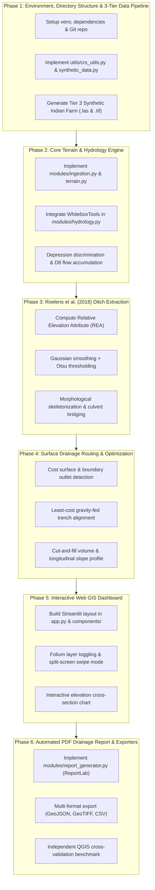

# 05: Development Roadmap & UI Specification

## 1. Phased Development Roadmap

The project is structured into six sequential phases with clear deliverables, acceptance criteria, and unit test milestones:



---

## 2. Phase-by-Phase Deliverables & Acceptance Criteria

### Phase 1: Environment, Directory Structure & 3-Tier Data Pipeline
- **Deliverables:**
  - Pinned `requirements.txt` with tested package versions.
  - Project directory hierarchy (`modules/`, `components/`, `data/`, `outputs/`, `tests/`).
  - `utils/crs_utils.py` for UTM detection and reprojection.
  - `utils/synthetic_data.py` generating a $4\text{ ha}$ synthetic Indian farm GeoTIFF and LAS point cloud.
- **Acceptance Criteria & Unit Tests:**
  - `pytest tests/test_synthetic.py` passes.
  - Generated synthetic files open cleanly in QGIS with correct metric extents and coordinate system (EPSG:32643).

### Phase 2: Core Terrain & Hydrological Modeling Engine
- **Deliverables:**
  - `modules/ingestion.py`: Ingests `.las`, `.laz`, `.tif`; extracts metadata; filters ASPRS Class 2 ground points.
  - `modules/terrain.py`: Generates slope, aspect, hillshade, and contours.
  - `modules/hydrology.py`: WhiteboxTools wrapper for depression detection, selective breaching, D8 flow accumulation, and TWI.
- **Acceptance Criteria & Unit Tests:**
  - `pytest tests/test_ingestion.py` and `pytest tests/test_terrain.py` pass.
  - Waterlogging filter isolates genuine sinks ($>5\text{ cm}$ depth, $>3\text{ px}$ area) while discarding noise.

### Phase 3: Research-Backed Ditch Extraction Engine (Roelens et al.)
- **Deliverables:**
  - `modules/ditch_extraction.py`: Relative Elevation Attribute (REA), Gaussian smoothing, Otsu dynamic thresholding, morphological skeletonization, and culvert bridging.
- **Acceptance Criteria & Unit Tests:**
  - `pytest tests/test_ditch_extraction.py` passes.
  - Ditch centerline matches known synthetic ditch coordinates with $>90\%$ intersection-over-union.
  - Culvert bridging connects the two severed ditch segments across the synthetic farm road.

### Phase 4: Surface Drainage Routing & Optimization Engine
- **Deliverables:**
  - `modules/drainage_routing.py`: Identifies lowest boundary outlet; computes least-cost trench route from waterlogging sinks to outlet; ensures monotonic positive gradient ($>0.2\%$); calculates cut/fill volume.
- **Acceptance Criteria & Unit Tests:**
  - Proposed trench path has zero uphill sections ($\Delta Z \le 0$ along flow path).
  - Earthwork volume calculation returns accurate cubic meter estimates based on trapezoidal ditch cross-section.

### Phase 5: Interactive Web GIS Dashboard
- **Deliverables:**
  - `app.py`, `components/sidebar.py`, `components/map_view.py`, `components/elevation_profile.py`, `components/stats_cards.py`.
  - Streamlit dashboard with layer switcher (DTM, Hillshade, Slope, Flow Accumulation, Waterlogging Zones, Extracted Ditches, Proposed Routes).
  - Side-by-side comparison swipe tool (Raw DTM vs. Hydrological Hotspots).
  - Cross-section elevation profile along proposed drainage trench.
- **Acceptance Criteria:**
  - Web UI loads in $<3\text{ seconds}$.
  - Map pans, zooms, and toggles layers smoothly without re-running heavy hydrological computations.

### Phase 6: Automated PDF Drainage Report & Exporters
- **Deliverables:**
  - `modules/report_generator.py`: Multi-page ReportLab PDF builder with executive summary, landholding metrics, waterlogging risk analysis, proposed ditch specifications, and embedded cartographic figures.
  - Exporter for GeoJSON vectors (waterlogging zones, ditches, routes) and GeoTIFF rasters.
  - Independent QGIS validation check comparing outputs to GRASS/GDAL.
- **Acceptance Criteria:**
  - Generated PDF compiles cleanly without layout overflow or missing fonts.
  - Exported GeoJSON loads in QGIS without coordinate misalignment.

---

## 3. Streamlit Dashboard UI Wireframe & Layout Specification

```
+----------------------------------------------------------------------------------------------------------------------+
|  HEADER: [Icon] Field Drainage Using LiDAR | Intelligent Agricultural Drainage Decision System                       |
+----------------------------------------------------------------------------------------------------------------------+
|  SIDEBAR                       |  MAIN WORKSPACE                                                                     |
|                                |                                                                                     |
|  [Select / Upload Mode]        |  +-------------------------------------------------------------------------------+  |
|  (o) Tier 3: Synthetic Indian  |  | KPI METRICS BANNER                                                            |  |
|      Farm (Demo)               |  | [ Field Area: 4.0 Ha ] [ Max Slope: 1.8% ] [ Ponding Risk Area: 0.28 Ha (7%) ]|  |
|  ( ) Tier 2: Real LiDAR LAS/LAZ|  | [ Est. Water Stored: 342 m³ ] [ Proposed Ditch Length: 145 m ]                 |  |
|  ( ) Tier 1: Satellite GeoTIFF |  +-------------------------------------------------------------------------------+  |
|  [ Browse File... ]            |                                                                                     |
|                                |  +-------------------------------------------------------------------------------+  |
|  --- HYDRAULIC PARAMETERS ---  |  | TAB 1: INTERACTIVE GIS MAP (Folium / Leaflet)                                 |  |
|  Min Ponding Depth: [0.05 m]   |  |                                                                               |  |
|  Min Ponding Area:  [10.0 m²]  |  |  [Layer Toggle Menu: Top-Right]                                               |  |
|  Ditch Buffer Width: [2.5 m]   |  |   [x] High-Res DTM          [ ] Slope Heatmap                                 |  |
|  Min Route Gradient: [0.2 %]   |  |   [x] Multi-Hillshade       [x] D8 Flow Pathways                              |  |
|                                |  |   [x] Ponding Hotspots      [x] Existing Ditches                              |  |
|  [ EXECUTE ANALYSIS ]          |  |   [x] Proposed Gravity Trench                                                 |  |
|                                |  |                                                                               |  |
|  --- EXPORTS ---               |  |  [ Map Viewport: Split-Screen Comparison Slider Active ]                       |  |
|  [ Download PDF Report ]       |  |  Left: Raw DTM Hillshade      |  Right: Waterlogging & Proposed Drainage Route|  |
|  [ Export GeoJSON Vectors ]    |  |                                                                               |  |
|  [ Export Metric GeoTIFFs ]    |  +-------------------------------------------------------------------------------+  |
|                                |                                                                                     |
|  --- STATUS & LOGS ---         |  +-------------------------------------------------------------------------------+  |
|  CRS: EPSG:32643 (UTM 43N)     |  | TAB 2: LONGITUDINAL ELEVATION PROFILE                                         |  |
|  Resolution: 0.5 m/px          |  | [ Interactive Matplotlib/Plotly profile along proposed drainage trench ]      |  |
|  Status: Pipeline Ready        |  |  Shows Surface Invert, Continuous Downhill Gradient (>0.2%), and Cut Depth.  |  |
|                                |  +-------------------------------------------------------------------------------+  |
|                                |  +-------------------------------------------------------------------------------+  |
|                                |  | TAB 3: WATERLOGGING & DITCH ATTRIBUTE TABLE                                   |  |
|                                |  | [ Table listing Sink ID, Area (m²), Max Depth (cm), Stored Volume (m³), Risk ] |  |
|                                |  +-------------------------------------------------------------------------------+  |
+----------------------------------------------------------------------------------------------------------------------+
|  FOOTER: (c) 2026 Varad Patil. All Rights Reserved. | Proprietary Architecture | Indian Agri-Drainage Initiative       |
+----------------------------------------------------------------------------------------------------------------------+
```

---

## 4. Testing & Verification Milestones

Every PR or development iteration must satisfy the following automated verification suite:

1. **Ingestion & CRS Precision:**
   - Verify unprojected degree coordinates are rejected or properly transformed.
   - Verify non-ground LiDAR returns are removed before interpolation.
2. **Hydrological Monotonicity:**
   - Verify that all generated drainage routes maintain a strictly positive downward gradient ($Z_{i} > Z_{i+1}$) towards the outlet.
3. **Reproducibility with QGIS:**
   - Output rasters and vectors are loaded into an automated headless QGIS Python (`qgis.core`) script to verify that layer extents, cell values, and vector geometries align with zero discrepancy.
